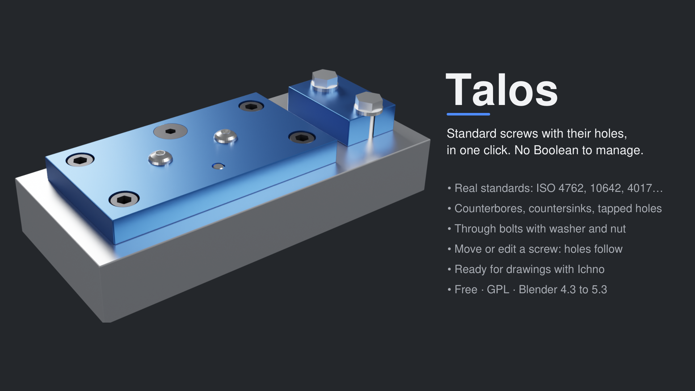
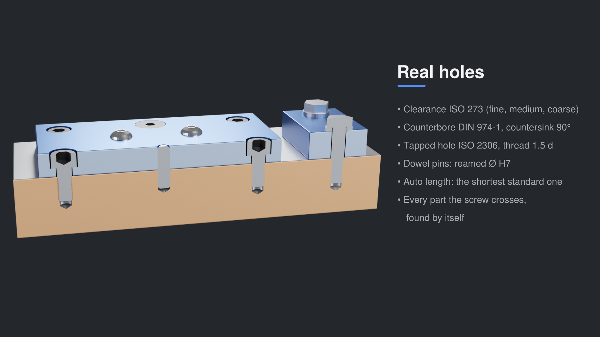
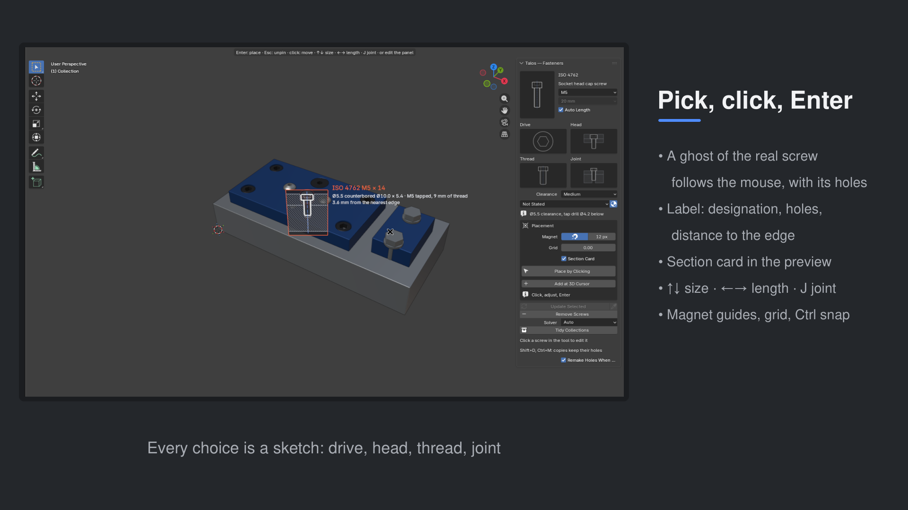
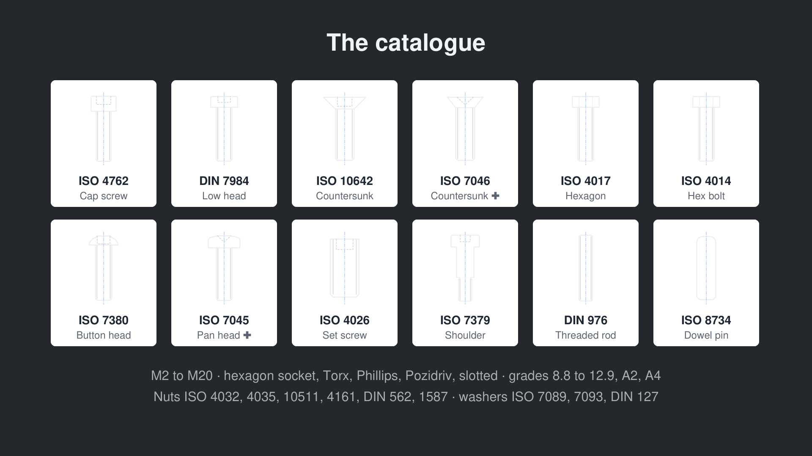
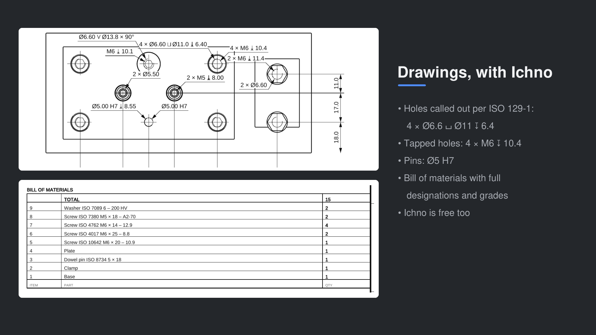

# Talos — standard screws with their holes, for Blender

Place standard screws, nuts, washers and pins in Blender **with their holes** — clearance, counterbore, countersink, tapped hole,
reamed hole for a pin — without ever touching a Boolean. Pick a screw, click on a part, press Enter: the screw is placed and every part
it crosses is drilled. Move it, the holes follow. Change it, screw and holes are rebuilt.

## Features
- **Place by Clicking** (Alt+Shift+T, or Shift+A ‣ Talos Screw): a ghost of the real screw follows the mouse with its holes and a label;
  ↑↓ size, ←→ length, J joint; magnet guides, grid, Ctrl to snap; a section card in the preview.
- **Real holes**: ISO 273 clearance (fine, medium, coarse), DIN 974-1 counterbores, 90° countersinks, ISO 2306 tapped holes, H7 pin holes;
  auto length; joints into the part below, through bolt with washer and nut, single part, tapped in the part.
- **Catalogue**: ISO 4762, DIN 7984, ISO 10642, ISO 7046, ISO 4017, ISO 4014, ISO 7380, ISO 7045, ISO 4026, ISO 7379, DIN 976,
  ISO 8734, ISO 2338 — M2 to M20; wood screws; inch screws (UNC); nuts, T-nuts and washers; hexagon socket, Torx, Phillips, Pozidriv, slotted; grades and materials.
- **Edit like objects**: click a placed screw to change or move it; Shift+D and Ctrl+M copies keep their holes; X leaves nothing behind;
  everything tidy in one *Talos* collection.
- **Drawings**: with [Ichno](https://github.com/Elyh29/ichno), holes are called out (4 × Ø6.6 ⌴ Ø11 ↧ 6.4) and the bill of materials
  lists full designations.

Blender 4.3 to 5.3 · English, French, German, Spanish · GPL-3.0-or-later.

## Install
Edit ‣ Preferences ‣ Get Extensions, search *Talos* — or ‣ ⌄ ‣ Install from Disk… and pick the zip. Panel: 3D View sidebar (N), tab **Talos**.

## Manual
[Home](docs/Home.md) · [Placing](docs/Placing.md) · [Joints and holes](docs/Joints-and-holes.md) · [Catalogue](docs/Catalogue.md) ·
[Editing](docs/Editing.md) · [With Ichno](docs/Ichno.md) · [Troubleshooting](docs/Troubleshooting.md)

## Changelog
See [CHANGELOG.md](CHANGELOG.md).

Issues and ideas: [GitHub issues](https://github.com/Elyh29/talos/issues).
