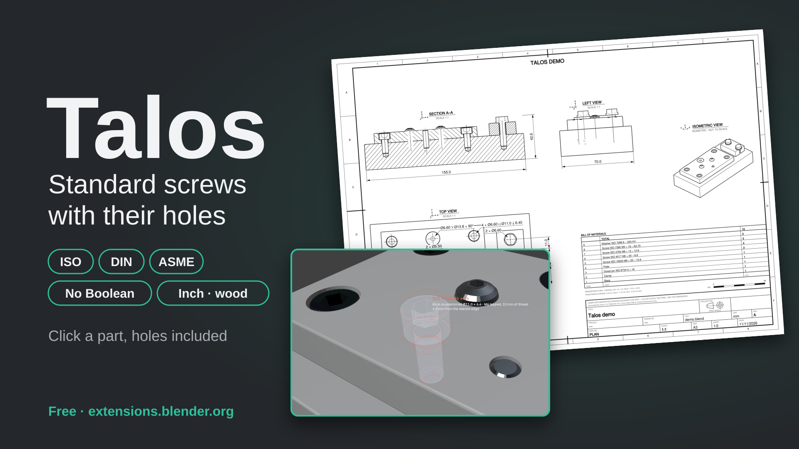
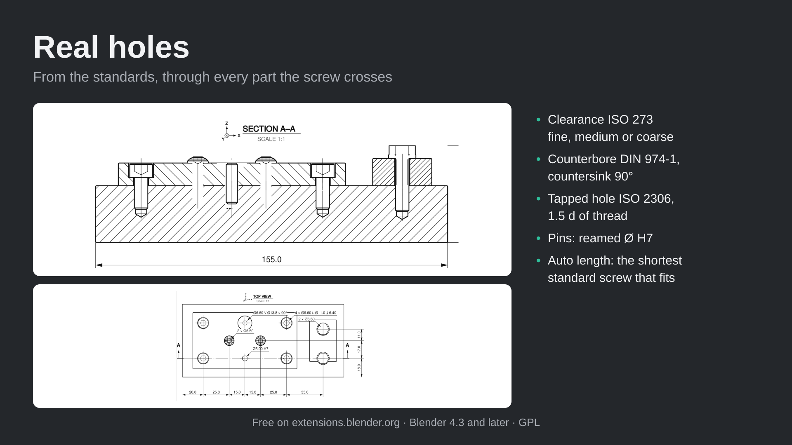
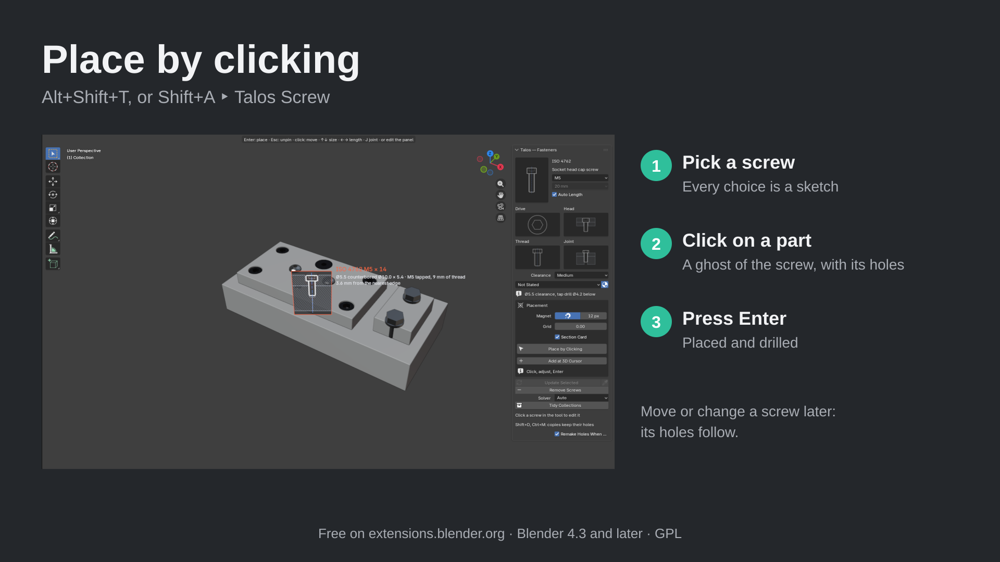
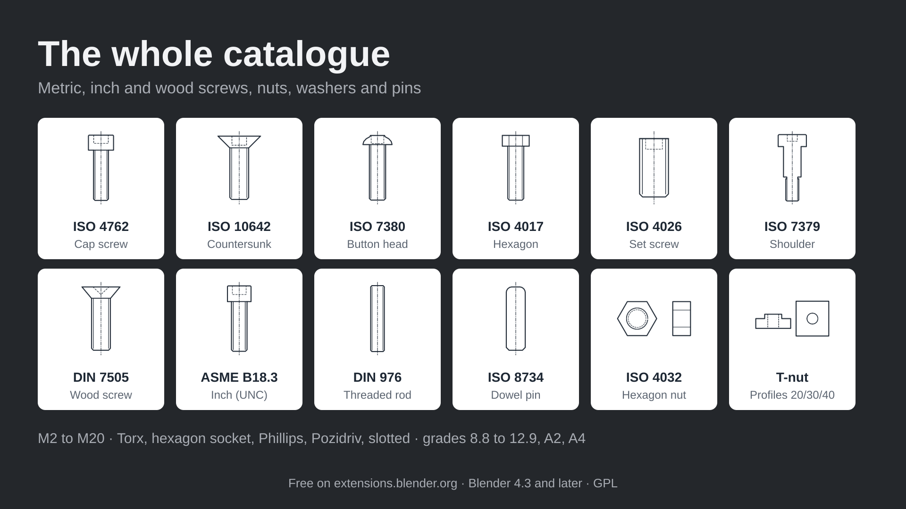
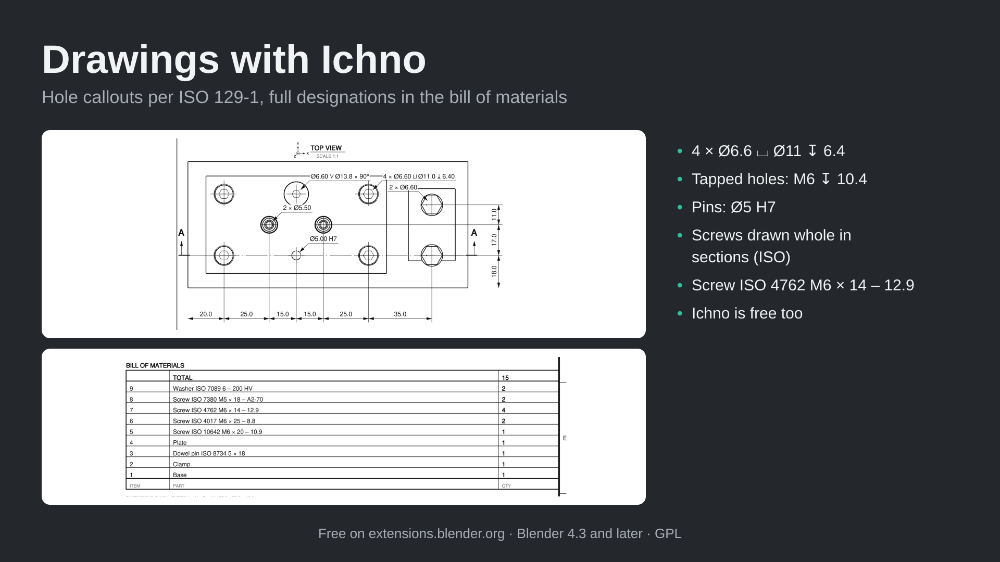

# Talos — standard screws with their holes, for Blender

**Free Blender add-on: place standard screws, nuts, washers and pins with their holes, in one click, without a Boolean to manage.**
Clearance, counterbore, countersink, tapped hole, reamed hole for a pin — through every part the screw crosses.

Talos is made for **mechanical assemblies, furniture and woodworking, 3D printed parts and product design** in Blender: pick a screw,
click on a part, press Enter. The screw is placed and every part it crosses is drilled, with real dimensions from the ISO, DIN and
ASME standards. Move the screw and its holes follow; change it and screw and holes are rebuilt.

## Install
- **Recommended:** Blender ‣ Edit ‣ Preferences ‣ Get Extensions, search for **Talos**.
- Or download the zip from [Releases](../../releases) and use *Install from Disk*.

Requires Blender 4.3 or newer (tested up to 5.3). Windows, macOS and Linux.

## Quick start
1. 3D Viewport ‣ Sidebar (N) ‣ **Talos** tab: choose the screw (type, size, joint) — every choice is a sketch.
2. **Place by Clicking** (or **Alt+Shift+T**, or Shift+A ‣ Talos Screw): a ghost of the real screw follows the mouse, with its holes.
3. Click to pin it, adjust it, press **Enter**: placed and drilled.

## Features

### Place by clicking
- A ghost of the real screw with its holes and a label: designation, holes, distance to the nearest edge, warnings
- ↑↓ size, ←→ length, J joint while the preview is pinned; magnet guides, grid, Ctrl to snap to vertices and edges
- **Patterns**: screws near the corners, in a line or on a circle (Tab, Page Up/Down, R), following curved parts
- Optional section card: a section through the screw in the preview
- Also at the 3D cursor, or on the selected faces in Edit Mode

### Real holes, from the standards
- Clearance holes **ISO 273** (fine, medium, coarse), counterbores **DIN 974-1**, 90° countersinks, tapped holes **ISO 2306**
- Joints: into the part below, through bolt with washer and nut, single part, tapped in the part
- Dowel pins: reamed hole **Ø H7** in each part; shoulder screws: H8 bore
- **Auto length**: the shortest standard screw for the parts crossed (1.5 d of thread, or room for the nut)
- One hidden cutter per hole and one Boolean per part, handled for you; Exact or Manifold solver

### The whole catalogue
- Cap, low head, countersunk, button, pan head, hexagon, set and shoulder screws, threaded rods, dowel pins — **M2 to M20**
- **Wood screws** with pilot holes for softwood, hardwood or chipboard
- **Inch screws** ASME B18.3 #4-40 to 1/2-13 (UNC), inch lengths, hex nuts and SAE washers
- Nuts (regular, thin, nylon lock, square, flange, acorn, **T-nuts** for 20/30/40 aluminium profiles) and washers
- Hexagon socket, Torx, Phillips, Pozidriv and slotted drives; grades 8.8 to 12.9, A2-70, A4-70, with matching materials

### Edit like objects
- Click a placed screw to change or move it; its old holes are removed, new ones cut
- Shift+D and Ctrl+M copies keep their holes; X leaves nothing behind; holes made again after a move
- Everything tidy in one **Talos** collection: fasteners by standard and size, holes by part

### Technical drawings with Ichno
With the free [Ichno](https://github.com/Elyh29/ichno) add-on, holes are called out per ISO 129-1 (`4 × Ø6.6 ⌴ Ø11 ↧ 6.4`, `M6 ↧ 10.4`,
`Ø5 H7`), screws are drawn whole in sections, and the bill of materials lists full designations (`Screw ISO 4762 M6 × 14 – 12.9`).

| | |
|---|---|
|  |  |
|  |  |

Interface in English, French, German and Spanish.

## Manual
[Home](docs/Home.md) · [Placing](docs/Placing.md) · [Joints and holes](docs/Joints-and-holes.md) · [Catalogue](docs/Catalogue.md) ·
[Editing](docs/Editing.md) · [With Ichno](docs/Ichno.md) · [Troubleshooting](docs/Troubleshooting.md)

## FAQ
**Do I need to manage Booleans?**
No. Each part gets one Boolean modifier « Fastener Holes » cutting a hidden collection of cutters; Talos keeps it up to date.

**Are the dimensions real?**
Yes: clearance, counterbore, tap drill and screw dimensions come from the ISO, DIN and ASME tables. Wood screws, shoulder screws and
T-nuts follow suppliers' catalogues: check them against yours.

**Does it work with heavy parts?**
Yes. On Blender 4.5 and later the Manifold solver cuts holes fast; parts must be closed meshes.

**Can I get the holes on a drawing?**
Yes, with Ichno (free): hole callouts, threads per ISO 6410, sections and bill of materials.

## Changelog
See [CHANGELOG.md](CHANGELOG.md).

## Bugs and ideas
Open an [issue](../../issues), with your Blender version and, if possible, a small .blend file.

## License
GPL-3.0-or-later, see [LICENSE](LICENSE).
