# Talos — Fasteners for Blender

Place standard screws, nuts, washers and pins in Blender **with their holes**, without ever touching a Boolean.
Pick a screw, click on a part: the screw is placed and the parts are drilled — clearance, counterbore, countersink, tapped
hole, reamed hole for a pin. Move the screw: its holes follow. Change it: screw and holes are rebuilt.

## Requirements
- Blender 4.3 or later (tested on 4.3, 4.5, 5.0, 5.2 and 5.3).
- Closed meshes for the parts (every edge between two faces): holes are cut by one Boolean modifier per part.

## Install
Edit ‣ Preferences ‣ Get Extensions ‣ ⌄ ‣ Install from Disk… and pick the zip. The panel is in the 3D View sidebar (N),
tab **Talos**. **Alt+Shift+T** in the 3D View (or **Shift+A ‣ Talos Screw**) starts *Place by Clicking*. The interface is in English,
French, German and Spanish.

## Pages
- [Placing screws](Placing.md) — the click tool, keys, magnet, curved parts, where things go in the Outliner.
- [Joints and holes](Joints-and-holes.md) — what gets drilled where, clearance series, solvers, applying holes.
- [Catalogue](Catalogue.md) — every standard and size.
- [Editing](Editing.md) — edit a placed screw, Shift+D, Ctrl+M, Update, Remove.
- [With Ichno](Ichno.md) — hole callouts, threads and bill of materials on the drawings.
- [Troubleshooting](Troubleshooting.md) — messages and what to do.
